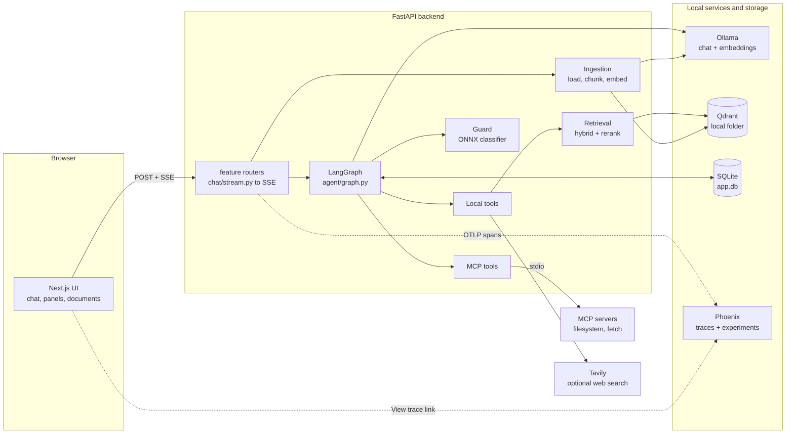
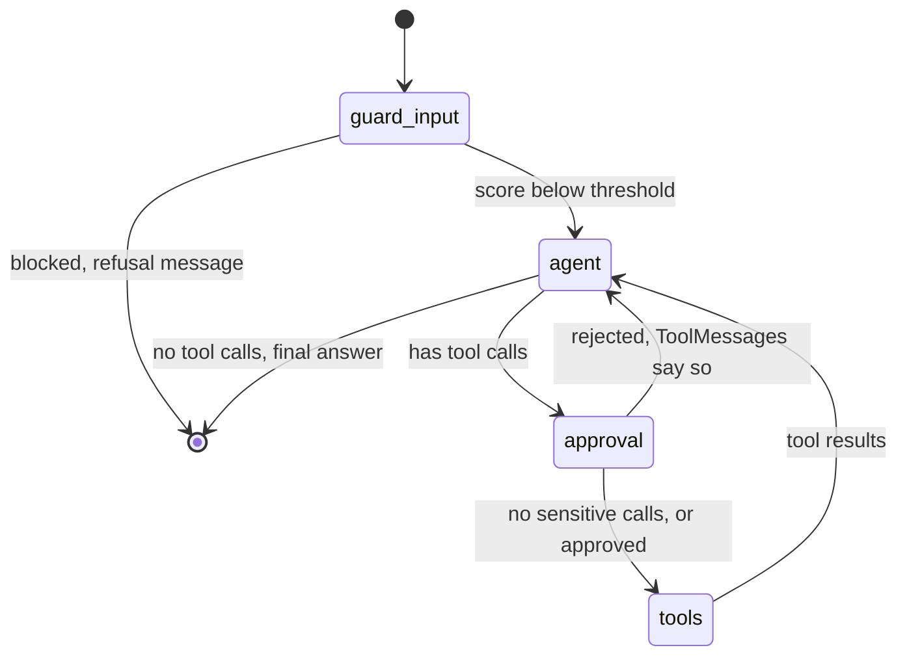
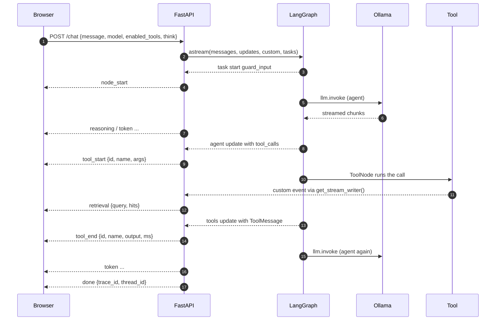
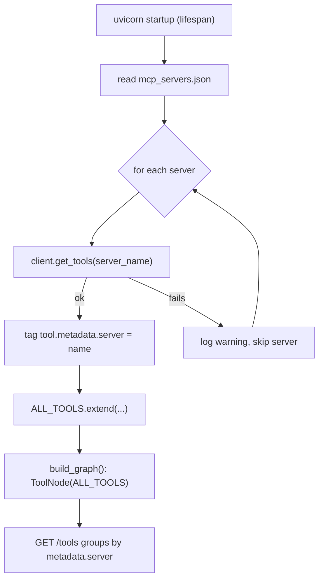
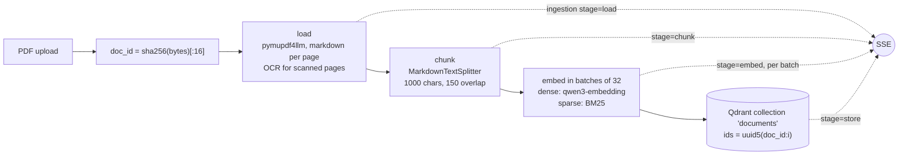
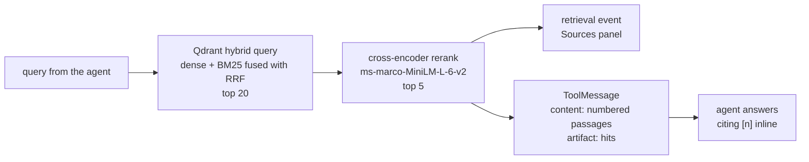
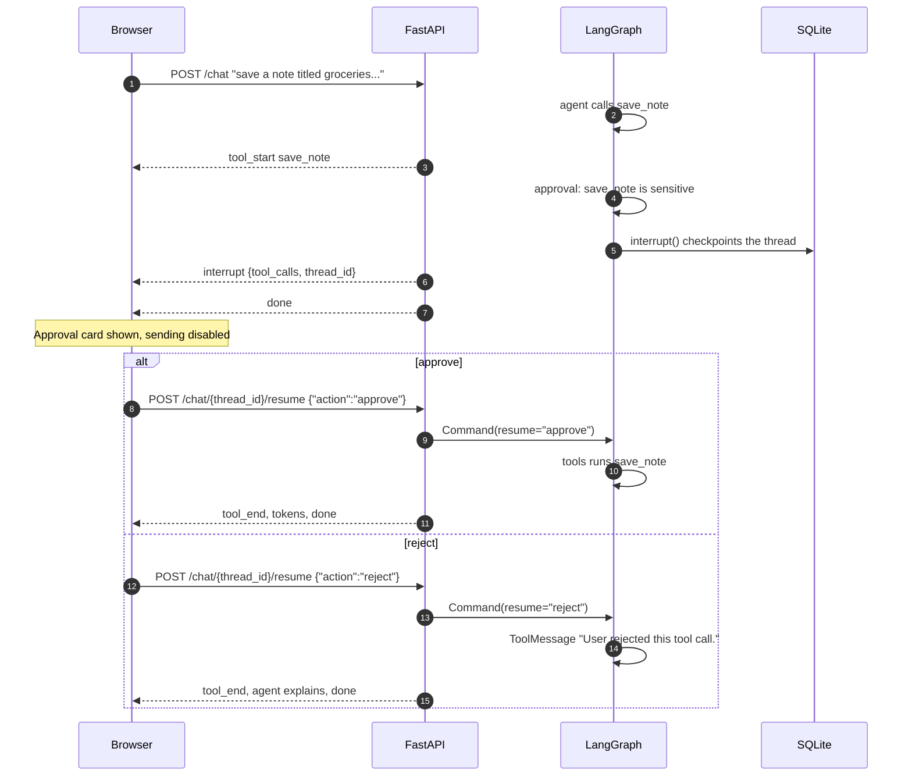
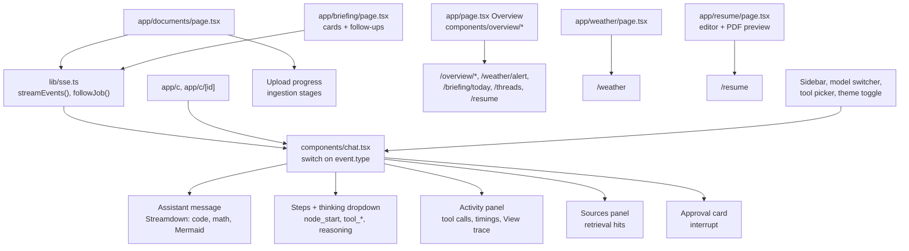
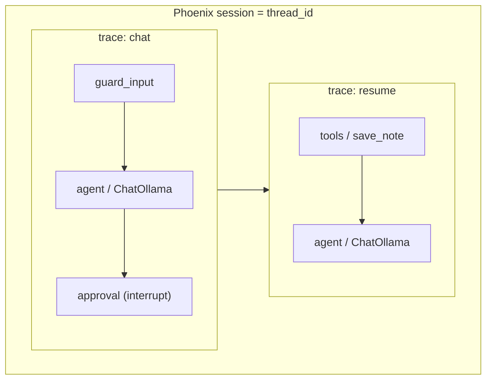
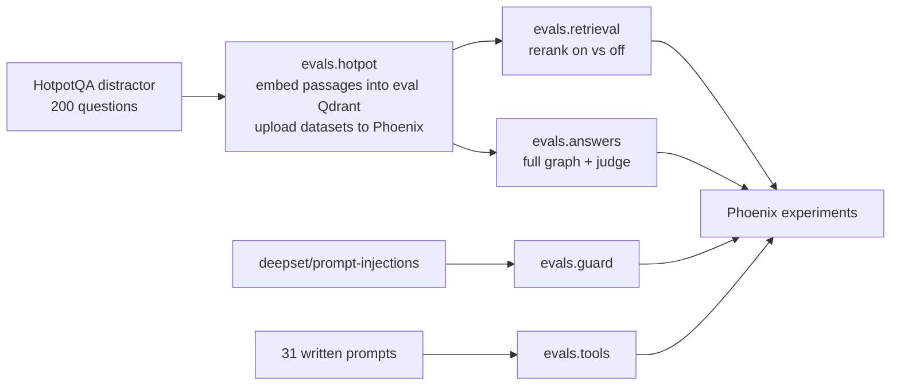

# Agent Chat

A local-first, ChatGPT/Claude-style agentic chat platform. Everything runs on your machine: models through Ollama, vectors in Qdrant local mode, threads in SQLite and traces in Phoenix.

It is a working showcase of:

- **Agent orchestration** with LangGraph (plain function nodes, direct `llm.invoke()`, no LCEL)
- **Tools and MCP**, local `@tool` functions and MCP servers side by side
- **RAG as a tool**: PDF ingestion, hybrid dense + BM25 search, cross-encoder reranking, inline citations; a chat searches the files attached to it
- **Human-in-the-loop**: sensitive tools pause the run until you approve or reject
- **Input guard**: an ONNX prompt-injection classifier in front of the agent
- **Ask about images**: attach a screenshot or photo and ask a local vision model (qwen3-vl) about it
- **Voice**: local speech to text (Parakeet) and text to speech (Kokoro) on onnxruntime
- **Draw**: the agent can generate images with SDXL Turbo on the Mac's GPU, shown inline in the answer
- **Mail and calendar**: read-only Gmail and Google Calendar tools (search and read mail, list events, find free slots) after a one-time Google login, see [docs/INTEGRATIONS.md](docs/INTEGRATIONS.md)
- **Overview**: a home page with today's schedule, inbox, weather, recent chats and system status; chat lives at `/c`
- **Briefing**: a daily page with what needs attention, today's (and in the evening tomorrow's) calendar, the mail worth a look and the weather; written on first open, with past days and follow-up questions on the page
- **Weather**: a weather app page with saved places and search, now, the next 24 hours, 7 days, wind, humidity, UV and sun times, refreshed every 15 minutes; rain alerts from 15-minute data on the Overview, and a `get_weather` chat tool (Open-Meteo, no key)
- **Background jobs**: chat answers, briefing follow-ups, PDF ingestion and the briefing run as in-process jobs, so they finish when the page closes and a reopened page picks up the live progress; the morning briefing is written at `briefing_at` (07:00) on its own
- **Resume**: an Overleaf-style LaTeX editor (Jake's Resume) with a live PDF preview, compiled locally with Tectonic; the agent can read and edit it behind an approval
- **Live event streaming** over SSE: tokens, reasoning, node and tool steps, retrieval hits, approvals
- **Observability and evals** with Phoenix: every chat is a trace, every eval suite is an experiment

The design notes and build order live in [docs/PLAN.md](docs/PLAN.md).

## Contents

- [Architecture](#architecture)
- [Quick start](#quick-start)
- [The agent graph](#the-agent-graph)
- [Streaming events](#streaming-events)
- [Tools and MCP](#tools-and-mcp)
- [RAG: ingestion and retrieval](#rag-ingestion-and-retrieval)
- [Human-in-the-loop](#human-in-the-loop)
- [Input guard](#input-guard)
- [Frontend](#frontend)
- [Observability](#observability)
- [Evals](#evals)
- [API reference](#api-reference)
- [Configuration](#configuration)
- [Project layout](#project-layout)
- [Extending](#extending)
- [Troubleshooting](#troubleshooting)

## Architecture



| Layer | Choice |
|---|---|
| Backend | FastAPI, uv, sse-starlette |
| Orchestration | LangGraph, plain function nodes |
| LLMs | Ollama via `ChatOllama` (qwen3, gpt-oss, llama3.1) |
| Embeddings | `qwen3-embedding:0.6b` (dense) via Ollama, fastembed `Qdrant/bm25` (sparse) |
| Rerank | fastembed `Xenova/ms-marco-MiniLM-L-6-v2`, in-process |
| PDF loading | `langchain-pymupdf4llm`, markdown per page, Tesseract OCR for scans |
| Chunking | `MarkdownTextSplitter` |
| Vector store | Qdrant local mode via `langchain-qdrant` |
| Checkpoints | SQLite (`AsyncSqliteSaver`) |
| MCP | `langchain-mcp-adapters` (`MultiServerMCPClient`) |
| Guard | `protectai/deberta-v3-base-prompt-injection-v2` on onnxruntime (no torch) |
| Voice | `onnx-asr` with `nemo-parakeet-tdt-0.6b-v2` (int8), `kokoro-onnx` with Kokoro 82M (int8) |
| Image generation | `diffusers` with `stabilityai/sdxl-turbo` (fp16) and `madebyollin/sdxl-vae-fp16-fix` on MPS |
| Observability | Phoenix (`arize-phoenix-otel` + OpenInference LangChain instrumentation) |
| Frontend | Next.js, Tailwind, shadcn/ui, Streamdown (code, math, Mermaid) |

## Quick start

### Prerequisites

- [uv](https://docs.astral.sh/uv/) for Python (3.13)
- Node and [pnpm](https://pnpm.io/) for the frontend
- `npx` and `uvx` on your PATH (the MCP servers are launched with them)
- [Ollama](https://ollama.com/) running locally
- Optional: Tesseract, for OCR of scanned PDFs
- Optional: [Tectonic](https://tectonic-typesetting.github.io) (`brew install tectonic`), for the resume page and tools
- Optional: a [Tavily](https://tavily.com/) API key, for web search

Pull the models:

```bash
ollama pull qwen3:8b
ollama pull qwen3-embedding:0.6b
# optional, for the model switcher and evals
ollama pull llama3.1:8b
ollama pull gpt-oss
# optional, for asking about images
ollama pull qwen3-vl:8b
```

### Run

Start the three processes in this order, each in its own terminal:

```bash
# 1. Tracing (http://localhost:6006). Start it first, see Troubleshooting.
uvx --from arize-phoenix phoenix serve

# 2. Backend (http://localhost:8000)
cd backend && uv run uvicorn main:app --port 8000

# 3. Frontend (http://localhost:3000)
cd frontend && pnpm install && pnpm dev
```

Open http://localhost:3000. Upload a PDF on the Documents page and press "Ask about this", or attach it in a chat from the `+` menu, then ask about it. A chat only searches the files attached to it; set `SEARCH_SCOPE=all` to search the whole library instead.

Optional settings go in `backend/.env`:

```bash
# Web search
TAVILY_API_KEY=tvly-...
# Weather: becomes the Home place on first start, used by the Overview, briefing and get_weather
WEATHER_LAT=52.37
WEATHER_LON=4.90
WEATHER_PLACE=Amsterdam
```

### Optional: Google mail and calendar

The mail and calendar tools, the Overview's inbox and schedule, and the briefing read your Google account (read-only).

1. In Google Cloud, create a project, turn on the Gmail API and the Google Calendar API, and create an OAuth client of type Desktop app.
2. Save its JSON as `backend/data/secrets/credentials.json`.
3. Log in once from `backend/`: `uv run python -m integrations.google_auth`. This saves `data/secrets/token.json`.
4. Set the OAuth app to In production (unverified is fine for personal use), or Google expires the login after 7 days.

Restart the backend and the tools appear. The details and limits of each tool are in [docs/INTEGRATIONS.md](docs/INTEGRATIONS.md).

### Try it from the terminal

Every endpoint can be exercised with `curl -N` before touching the UI:

```bash
# Stream a chat
curl -N -X POST localhost:8000/chat \
  -H 'Content-Type: application/json' \
  -d '{"message": "What is (17 + 25) * 3?"}'

# Upload a PDF and watch ingestion progress
curl -N -F file=@paper.pdf localhost:8000/documents

# Approve a paused tool call
curl -N -X POST localhost:8000/chat/<thread_id>/resume \
  -H 'Content-Type: application/json' \
  -d '{"action": "approve"}'
```

## The agent graph

The graph lives in [backend/agent/graph.py](backend/agent/graph.py). Every node is a plain function.



| Node | What it does |
|---|---|
| `guard_input` | Scores the latest user message with the injection classifier. At or above `guard_threshold` it emits a `guard` event and ends the turn with a refusal `AIMessage`, so thread history stays coherent. |
| `agent` | Builds `ChatOllama` for the thread's model, binds only the enabled tools, calls `llm.invoke()`. With `think` on, reasoning is moved into `reasoning_content` and streamed separately. With files attached it adds a note naming them; with none attached (and `search_scope` at `attachments`) it leaves out `search_documents`. |
| `approval` | If any tool call is in `SENSITIVE_TOOLS`, calls `interrupt()` and waits. Reject answers every call in the message with a ToolMessage so the agent can adapt. |
| `tools` | Prebuilt `ToolNode` holding all local and MCP tools. |

State is small:

```python
class ChatState(TypedDict, total=False):
    messages: Annotated[list, add_messages]
    model: str
    enabled_tools: list[str]  # missing means all tools
    think: bool
    attachments: Annotated[list[dict], merge_attachments]  # [{doc_id, name}], only accumulate
```

RAG is a tool (`search_documents`), not a fixed pipeline step. The agent decides when to retrieve.

## Streaming events

Every stream (`/chat`, `/chat/{id}/resume`, `/documents`, `/briefing`, `/jobs/{id}/events`) speaks one vocabulary: each SSE message is a JSON object with a `type` field. These streams all run as [background jobs](#api-reference), so each one starts with a `job` event.



| type | Payload | Source |
|---|---|---|
| `job` | `job_id`, `kind`, `ref` | always first, from the job runner; `ref` is the thread or doc id |
| `node_start` | `node` | `tasks` stream mode, a task without a `result` |
| `token` | `text` | `messages` stream mode |
| `reasoning` | `text` | `reasoning_content` on message chunks, when thinking is on |
| `tool_start` | `id`, `name`, `args` | `agent` update with tool calls |
| `tool_end` | `id`, `name`, `output` (first 500 chars), `ms` | `tools` or `approval` update |
| `retrieval` | `query`, `hits: [{doc, doc_id, page, score, text}]` | `custom`, from `search_documents` |
| `image` | `image_id`, `prompt` | `custom`, from `generate_image` |
| `ingestion` | `doc_id`, `stage` (load / chunk / embed / store), `done`, `total` | ingestion pipeline |
| `interrupt` | `tool_calls`, `thread_id` | `__interrupt__` update |
| `guard` | `blocked`, `score` | `custom`, from `guard_input` |
| `stage` | `stage` (`gathering`, `writing`) | briefing |
| `briefing` | `briefing` | briefing, the finished page data |
| `title` | `title`, `thread_id` | a new chat's generated title, before `done` |
| `error` | `message` | any exception in the stream |
| `done` | `trace_id`, `thread_id` | always last |

Tools emit fully formed events through `get_stream_writer()` and `/chat` forwards every `custom` chunk as is, so a new event type needs one new `case` in the frontend and nothing else.

## Tools and MCP

Local tools live in their feature's `tool.py` (or in [backend/tools/](backend/tools/) when they belong to no feature) and are registered in `ALL_TOOLS` in [backend/tools/\_\_init\_\_.py](backend/tools/__init__.py). Some are only registered when what they need is there:

| Tool | Purpose | Registered | Sensitive |
|---|---|---|---|
| `get_datetime` | Current local date, time and weekday | always | |
| `calculator` | Safe arithmetic via an AST walker (`+ - * / // % **`) | always | |
| `search_documents` | Hybrid search + rerank over the chat's attached documents | always (left out of a chat with no attachments) | |
| `save_note` | Writes a markdown note to `data/notes/` | always | yes |
| `generate_image` | Draws a 512x512 image with SDXL Turbo, stored like uploaded images | always | yes |
| `get_weather` | Forecast for a saved place, a searched place or Home, for a given day | always | |
| `web_search` | Tavily search | `TAVILY_API_KEY` is set | |
| `search_emails`, `read_email` | Search Gmail by time range, sender or topic; open one email | `data/secrets/token.json` exists | |
| `list_events`, `free_slots` | Calendar events for a day or range; free gaps in working hours | the token has `calendar.readonly` | |
| `read_resume`, `edit_resume` | Read the resume LaTeX; find and replace in it, saved only if it compiles | `tectonic` is on PATH | `edit_resume` |

MCP servers are declared in [backend/mcp_servers.json](backend/mcp_servers.json) in `MultiServerMCPClient` format and loaded once at startup:

| Server | Launch | Notes |
|---|---|---|
| `filesystem` | `npx @modelcontextprotocol/server-filesystem data/workspace` | Rooted at `backend/data/workspace/`. `write_file`, `edit_file`, `move_file`, `create_directory` need approval. |
| `fetch` | `uvx mcp-server-fetch` | Fetches a URL as markdown. |



MCP tools behave exactly like local ones: the agent binds them, `ToolNode` runs them, and `tool_end` uses `msg.text` so MCP content blocks read like plain output. Sessions are stateless, one stdio process per call, so each call pays the spawn cost (around 20s for the `npx` filesystem server).

## RAG: ingestion and retrieval

### Ingestion

`POST /documents` saves the upload to `data/uploads/` and streams progress while [backend/documents/ingestion/pipeline.py](backend/documents/ingestion/pipeline.py) runs. Blocking work runs in a thread.



- Ids are stable (sha256 of the file, uuid5 per chunk), so re-uploading a file overwrites rather than duplicates.
- Dense and sparse vectors are both stored at ingest time, so hybrid search never needs a re-ingest.
- Each chunk keeps `doc_id`, `doc`, `page` and `chunk_index` in its metadata.

### Retrieval



With `search_scope` at `attachments` (the default), the hybrid query is filtered to the `doc_id`s attached to the chat, which `search_documents` reads from graph state; the model never sees that argument. The evals use `all`.

Sources ride on the `search_documents` ToolMessage `artifact` rather than a separate state key. That avoids reducer conflicts on parallel calls and keeps sources tied to their turn in the checkpointed history. Page numbers from pymupdf4llm are 0-indexed and shown 1-indexed.

## Human-in-the-loop

Threads are checkpointed in SQLite, so a run can pause in the middle and pick up in a later request.



`/resume` returns `409` if the thread has no pending approval. A resumed run streams into the same assistant message in the UI, and both the chat and its resumes share one Phoenix session (`session.id = thread_id`).

## Input guard

[backend/core/guard.py](backend/core/guard.py) runs `protectai/deberta-v3-base-prompt-injection-v2` with onnxruntime and tokenizers, no torch. The model is downloaded from Hugging Face on first use and cached.

- Only the user message is checked. Tool and RAG output are not (that is a future `guard_output` node).
- Messages scoring `>= 0.9` are blocked. Benign text containing words like "ignore" can score around 0.88, so the threshold stays high. The [guard eval](#evals) reports precision and recall at 0.5, 0.7 and 0.9.
- A block emits a `guard` event, logs a warning, and ends the turn with a refusal whose score sits in `response_metadata`.

## Frontend

The Next.js app in [frontend/](frontend/) calls the API directly with CORS. A Next proxy could buffer SSE, so there is none. Streams are read with `fetch` and a 25 line parser in [frontend/lib/sse.ts](frontend/lib/sse.ts), since `EventSource` cannot POST.



| Feature | Detail |
|---|---|
| Model switcher | Lists `chat_models` from `/models`. The thinking toggle appears only for models with Ollama's `thinking` capability; models with `vision` are marked "sees". |
| Images | "Upload images" in the `+` menu or drag and drop (png, jpeg, webp). Downscaled in the browser to 1536 px, shown as thumbnails on the message. Send is blocked while images are attached and the model can't see. |
| Tool picker | Per-chat toggles from `/tools`, grouped by `local` or MCP server, sensitive tools marked. Stored in graph state, so resumes keep them. |
| Activity panel | Tool calls with args, output and timing for the selected turn, plus a "View trace" link to Phoenix. |
| Sources panel | Reranked passages with document, page and score. |
| Mic button | Push-to-talk in the composer. Records, converts to 16 kHz WAV in the browser, and appends the transcript to the input; nothing is sent until you press Send. Stops itself at 25 s. |
| Read aloud | A speaker button under each answer, one answer at a time. Code is skipped and tables are announced. Answers to questions asked by voice are read automatically. |
| Attachments | "Upload PDFs" in the `+` menu ingests a file and attaches it to the chat; the library picker attaches one already ingested. A chat searches only its attachments. |
| Documents page | The library from `GET /documents` with status, pages and chunks; upload with live per-stage progress, which a reopened page picks up again. "Ask about this" opens a new chat with the file attached. |
| Overview | `/`: today's schedule, inbox, weather with a rain banner, the briefing's heads up, recent chats, the resume and system status. Each widget loads on its own and says so when its source is not set up. |
| Briefing | `/briefing`: today's briefing as cards, written on first open (with stages), past days, and follow-up questions that run as a chat. |
| Weather | `/weather`: saved places, search and my location, now, 24 hours, 7 days and details. |
| Resume | `/resume`: LaTeX editor with a live PDF preview, the compile log and version history. |

## Observability

`phoenix.otel.register(auto_instrument=True)` traces every LangChain and LangGraph call. Each request opens one root span (`chat`, `resume` or `ingest`) with the user input and final answer, and FastAPI's own request tracing is turned off so Phoenix shows only the useful spans.



The `done` event carries the `trace_id`, and the UI links to Phoenix's `/redirects/traces/{trace_id}`, which resolves the project itself. Traces go to the `agent-chat` project.

## Evals

One suite per component in [backend/evals/](backend/evals/), on public or written datasets, with our own evaluators, all run as Phoenix experiments. Importing `evals` points Qdrant at a separate `data/eval_qdrant/` folder, so real uploads stay untouched and there is no lock clash with a running backend.



| Suite | Dataset | What it measures |
|---|---|---|
| `evals.retrieval` | `hotpot-retrieval-v1` (200 HotpotQA questions) | hit@5, recall@5 and MRR over gold paragraph titles, with and without the reranker |
| `evals.answers` | `hotpot-answers-v1` (50 questions) | Full graph with only `search_documents` enabled: used-search, contains-answer, answer-recall, and a faithfulness judge (`gpt-oss`, never grading its own answers) for `qwen3:8b` and `llama3.1:8b` |
| `evals.guard` | `deepset/prompt-injections` test split | Accuracy, missed injections and false blocks, plus a precision / recall / FPR table at 0.5, 0.7 and 0.9 |
| `evals.tools` | `tool-routing-v1` (31 written prompts) | Whether the first agent step calls the expected tool, or none, per model |

Run them with Phoenix and Ollama up. The backend can keep running, since the evals use their own Qdrant folder:

```bash
cd backend
uv run python -m evals.hotpot      # once: builds the eval store and uploads the HotpotQA datasets
uv run python -m evals.retrieval
uv run python -m evals.answers     # slow: full graph runs plus a judge call per question
uv run python -m evals.guard
uv run python -m evals.tools
```

Each suite prints mean scores to the terminal; the per-example runs and comparisons are in Phoenix under Datasets.

## API reference

| Method | Path | Body | Returns |
|---|---|---|---|
| `POST` | `/chat` | `{message, model?, thread_id?, enabled_tools?, think?, attachments?, images?}` | SSE stream. A new `thread_id` is created when omitted. `409` while an answer is still being written in that thread. |
| `POST` | `/chat/{thread_id}/resume` | `{"action": "approve" \| "reject"}` | SSE stream, or `409` with no pending approval |
| `GET` | `/threads` | `?limit=30&before=` | `{threads: [{thread_id, title, created_at, updated_at}], next}`, most recently updated first; pass `next` as `before` for the next page |
| `GET` | `/threads/{thread_id}` | | The thread plus `model`, `enabled_tools`, `think` and `messages` (rebuilt with their events), or `404` |
| `DELETE` | `/threads/{thread_id}` | | `{deleted}`; removes the checkpoints too |
| `POST` | `/documents` | multipart `file` | SSE stream of `ingestion` events, then `done`; the same file twice joins one job |
| `GET` | `/documents` | | The library, newest first: `[{doc_id, name, path, size_bytes, pages, chunks, status, error, created_at}]`; `status` is `ingesting`, `ready` or `failed` |
| `GET` | `/documents/{doc_id}` | | One library row, or `404` |
| `POST` | `/briefing` | | SSE: starts (or joins) the job writing today's briefing: `job`, `stage` (`gathering`, `writing`), `briefing`, `done`; takes 15 to 45 s |
| `GET` | `/briefing` | | `[{day, created_at}]`, newest first |
| `GET` | `/briefing/{day}` | | `today` or `YYYY-MM-DD`: `{day, created_at, thread_id, heads_up, mail, mail_text, mail_note, today, tomorrow, weather, job_id}`; `202 {job_id}` while today's is being written; `404` when none |
| `GET` | `/weather` | `?place_id=` or `?lat=&lon=` | Home's forecast when neither: `{place, current, hourly (24), daily (7), minutely, summary, alert, fetched_at}`; cached 10 minutes |
| `GET` | `/weather/alert` | | `{alert, place}` for Home; `alert` is null when no rain starts or stops within the hour |
| `GET` | `/weather/search` | `?q=` | Up to 8 `{name, region, country, lat, lon}` |
| `GET/POST` | `/weather/places` | `{name, region, country, lat, lon}` | Saved places; the first becomes Home |
| `POST` | `/weather/places/{id}/home` | | Makes it Home |
| `DELETE` | `/weather/places/{id}` | | Removes it; `400` for Home |
| `GET` | `/jobs` | `?kind=&ref=&status=` | Recent jobs (chat, ingest, briefing), newest first; `status=running` finds one to reattach to |
| `GET` | `/jobs/{id}` | | The job, and whether its events can still be followed |
| `GET` | `/jobs/{id}/events` | `?after=` | SSE: every event so far, then live ones until the job ends; `404` once it is gone (10 minutes after finishing) |
| `GET` | `/resume` | | `{tex, updated_at, has_pdf}`; the first call starts from the template |
| `PUT` | `/resume` | `{tex}` | `{ok, log, tex, updated_at, has_pdf}`; saved only if it compiles, `log` holds the LaTeX error |
| `GET` | `/resume/pdf` | | the compiled PDF, or `404` |
| `GET` | `/resume/history` | | `[{name, saved_at}]`, newest first |
| `POST` | `/resume/restore` | `{name}` | same as `PUT /resume` |
| `GET` | `/overview/{schedule,inbox,weather,status}` | | One widget's data; `{connected: false}` when its source is not set up, `502` when it fails |
| `GET` | `/models` | | `{models: [{name, thinking, vision}], default}` |
| `POST` | `/images` | multipart `file` (png, jpeg, webp, up to 10 MB) | `{image_id, name}`, or `400` |
| `GET` | `/images/{image_id}` | | the image, or `404` |
| `GET` | `/tools` | | `[{name, description, group, sensitive}]` |
| `POST` | `/voice/transcribe` | multipart `file` (16-bit PCM WAV) | `{text}`, or `400` for unreadable audio |
| `POST` | `/voice/speak` | `{text}` (1 to 1000 chars) | `audio/wav`, 24 kHz mono |

The first voice call downloads its model (about 650 MB for speech to text, 140 MB for text to speech), so it takes a while once. After that a sentence takes well under a second each way.

`enabled_tools` left out keeps the thread's earlier choice; never set means all tools. `attachments` is a list of `doc_id`s from the library; each must be `ready` (`400` otherwise), and they stay attached to the thread for later turns. `images` is a list of `{image_id, name}` from `POST /images`; they belong to that message only. A model without Ollama's `vision` capability gets an `[image: name]` placeholder instead.

## Configuration

Backend settings are in [backend/core/config.py](backend/core/config.py) (pydantic-settings). Any field can be overridden by an environment variable or `backend/.env`, for example `DEFAULT_MODEL=llama3.1:8b`.

| Setting | Default | Notes |
|---|---|---|
| `ollama_url` | `http://localhost:11434` | |
| `default_model` | `qwen3:8b` | |
| `chat_models` | `qwen3:8b`, `gpt-oss:latest`, `llama3.1:8b`, `qwen3-vl:8b` | Offered in the model switcher; need Ollama's `tools` capability |
| `num_ctx` | `8192` | Context window for the agent. Ollama's 4096 default is overflowed by all tool schemas plus an image |
| `phoenix_endpoint` | `http://localhost:6006/v1/traces` | |
| `phoenix_project` | `agent-chat` | |
| `tavily_api_key` | empty | `web_search` is registered only when set |
| `cors_origins` | `["http://localhost:3000"]` | |
| `qdrant_path` / `qdrant_collection` | `data/qdrant` / `documents` | |
| `search_scope` | `attachments` | `attachments`: a chat searches only its attached files; `all`: the whole collection (the evals use this) |
| `embedding_model` / `sparse_model` | `qwen3-embedding:0.6b` / `Qdrant/bm25` | |
| `chunk_size` / `chunk_overlap` | `1000` / `150` | |
| `retrieval_k` / `rerank_top_n` | `20` / `5` | |
| `rerank_model` | `Xenova/ms-marco-MiniLM-L-6-v2` | |
| `guard_model` / `guard_threshold` | `protectai/deberta-v3-base-prompt-injection-v2` / `0.9` | |
| `upload_dir`, `notes_dir`, `db_path` | `data/uploads`, `data/notes`, `data/app.db` | |
| `image_dir` / `image_max_mb` | `data/uploads/images` / `10` | Chat images, stored under a content hash, never ingested |
| `mcp_config` / `mcp_workspace` | `mcp_servers.json` / `data/workspace` | The workspace must match the filesystem root in the JSON |
| `stt_model` | `nemo-parakeet-tdt-0.6b-v2` | Any `onnx-asr` model name; English only by default |
| `tts_voice` / `tts_speed` | `af_heart` / `1.0` | Kokoro voice names are listed in its VOICES.md |
| `voice_dir` | `data/voice_models` | Kokoro files, downloaded on first use |
| `image_model` / `image_vae` | `stabilityai/sdxl-turbo` / `madebyollin/sdxl-vae-fp16-fix` | About 7 GB, downloaded to the Hugging Face cache on the first drawing |
| `image_steps` | `2` | 1 to 4 for Turbo |
| `image_unload_after_s` | `300` | Idle seconds before the image model is freed |
| `google_credentials` / `google_token` | `data/secrets/credentials.json` / `data/secrets/token.json` | The OAuth client and the token the login saves; the mail and calendar tools need the token |
| `work_day_start` / `work_day_end` | `09:00` / `18:00` | `free_slots` only looks inside these hours, local time |
| `weather_lat` / `weather_lon` / `weather_place` | unset / unset / `Home` | Seeds the Home place on first start; without it, add a place on the Weather page |
| `briefing_at` | `07:00` | Local time the morning briefing is written if none exists yet; `""` turns it off |
| `resume_dir` | `data/resume` | `resume.tex`, its PDF and earlier versions |

Frontend environment:

| Variable | Default |
|---|---|
| `NEXT_PUBLIC_API_URL` | `http://localhost:8000` |
| `NEXT_PUBLIC_PHOENIX_URL` | `http://localhost:6006` |

Everything the backend writes (SQLite, Qdrant, uploads, notes, the MCP workspace, voice models, the resume, Google secrets) lives in `backend/data/`, which is gitignored along with `.env`.

## Project layout

```
backend/
  main.py             FastAPI app, lifespan, CORS; lists each area's store and router
  mcp_servers.json    MCP servers loaded at startup
  core/               shared plumbing: config, db (connect, init_db), events, tracing, guard
  jobs/               background jobs: runner, jobs table, /jobs
  integrations/       Google auth, Gmail, Calendar clients
  agent/              LangGraph graph, Ollama model capabilities, /models and /tools
  chat/               /chat: the turn, graph stream to SSE events, titles
  threads/            /threads: threads table, history for the UI
  documents/          /documents: table, search tool, ingestion/ and retrieval/
  images/             /images: image store, SDXL Turbo generation, generate_image tool
  weather/            /weather: Open-Meteo client, places table, get_weather tool
  resume/             /resume: LaTeX resume, template, read and edit tools
  voice/              /voice: speech to text, text to speech
  overview/           /overview: dashboard widgets
  briefing/           /briefing: compose, briefings table, morning scheduler
  tools/              ALL_TOOLS and SENSITIVE_TOOLS registry, plus tools with no feature of their own
  evals/              hotpot setup, retrieval, answers, guard, tools suites
  data/               everything the app writes (gitignored)
frontend/
  app/                / overview, c/ and c/[id] chat, documents, briefing, weather, resume
  components/         chat, sidebar, steps, activity, sources, approval card, tool picker, attachments
    overview/         Overview widgets and the shared timeline
    briefing/         briefing cards and follow-ups
    weather/          now, hourly, daily, details, places
    resume/           editor, preview, compile log, history
    ui/               shadcn/ui primitives
  lib/                sse.ts (POST + SSE reader, job follow), upload.ts, voice.ts
docs/
  PLAN.md             design, decisions log, build order
  INTEGRATIONS.md     Gmail, Calendar, briefing: setup, behavior, limits
  FUNTODOS.md         feature ideas
```

## Extending

The rule is extend by adding, not rewiring.

- **A feature:** add a folder with `router.py` (thin, its own prefix and tags), plus `store.py` (its table and an `init(conn)`), `tool.py` and logic files as needed. Then add one line each to `ROUTERS` and `STORES` in `main.py`, and its tool to `tools/__init__.py`. Features import from `core/`, `jobs/` and `integrations/`; imports between features must not form a cycle.
- **A tool:** put an `@tool` function in its feature's `tool.py` (or in `backend/tools/` if it belongs to no feature) and add one line to `ALL_TOOLS`. If it has side effects, add its name to `SENSITIVE_TOOLS` and it gets an approval card for free. If it needs a key, token or binary, register it only when that exists, like `web_search`, so the agent never sees a tool that can't run.
- **An MCP server:** add an entry to `mcp_servers.json`. Its tools appear in `/tools` grouped under the server name. Add any write tools to `SENSITIVE_TOOLS`.
- **A model:** `ollama pull` it and add it to `chat_models`. Thinking support is detected from Ollama.
- **An event:** call `get_stream_writer()({"type": "...", ...})` from a node or tool, then add one `case` in the frontend.

## Troubleshooting

- **Every request is slow.** Phoenix is probably down; span export retries block requests. Start Phoenix before the backend.
- **Qdrant "already accessed by another instance".** Local mode locks the folder to one process. Inspect it through the API, or stop uvicorn first. The evals use their own folder for this reason.
- **The first filesystem MCP call takes ~20s.** Each call spawns a fresh `npx` process. Expected for now.
- **`web_search` is missing from the tool picker.** Set `TAVILY_API_KEY` in `backend/.env` and restart.
- **The agent ignores my PDF.** A chat only searches the files attached to it. Attach it from the `+` menu, or use "Ask about this" on the Documents page.
- **Mail or calendar tools are missing.** There is no `data/secrets/token.json` yet, or it was saved before the calendar scope was added. Run `uv run python -m integrations.google_auth` again and restart.
- **Google asks to log in again after a week.** The OAuth app is in Testing mode, which expires refresh tokens after 7 days. Set it to In production.
- **The Resume page or resume tools are missing.** Install Tectonic (`brew install tectonic`) and restart the backend.
- **A model has no thinking toggle.** Only models whose Ollama capabilities include `thinking` get one; a model that is not pulled shows without it.
- **The first drawing takes a while.** The first call downloads about 7 GB, and every cold start loads the model (10 to 15 s). Warm drawings take a few seconds. SDXL Turbo is under a non-commercial research license.
- **Prices render as math.** Inline `$...$` math is on in Streamdown, so text with two dollar amounts can occasionally be read as a formula.
