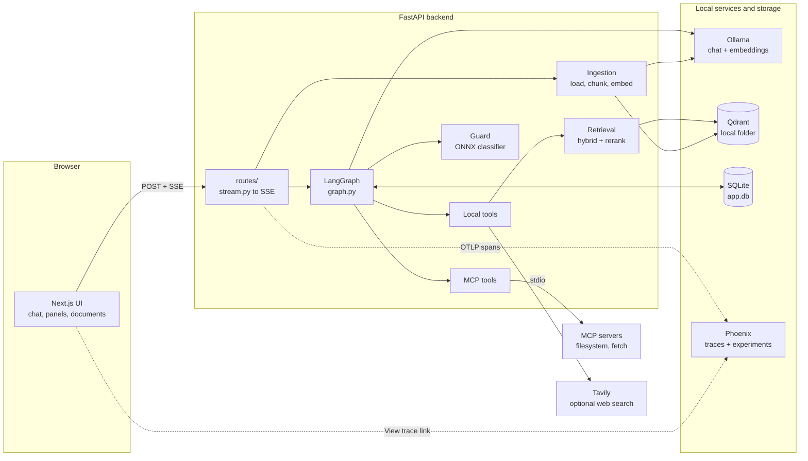
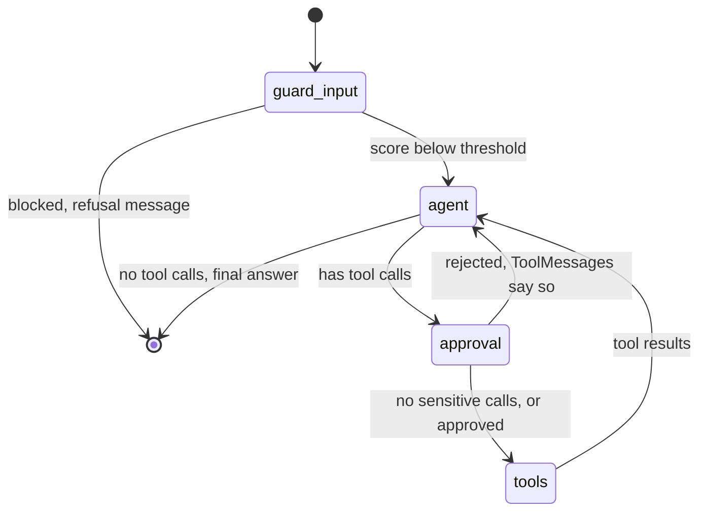
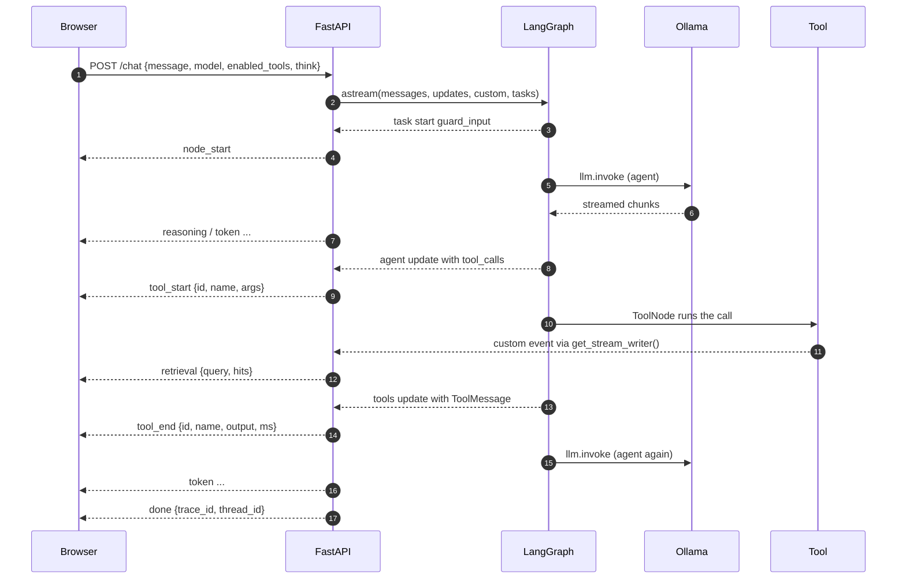
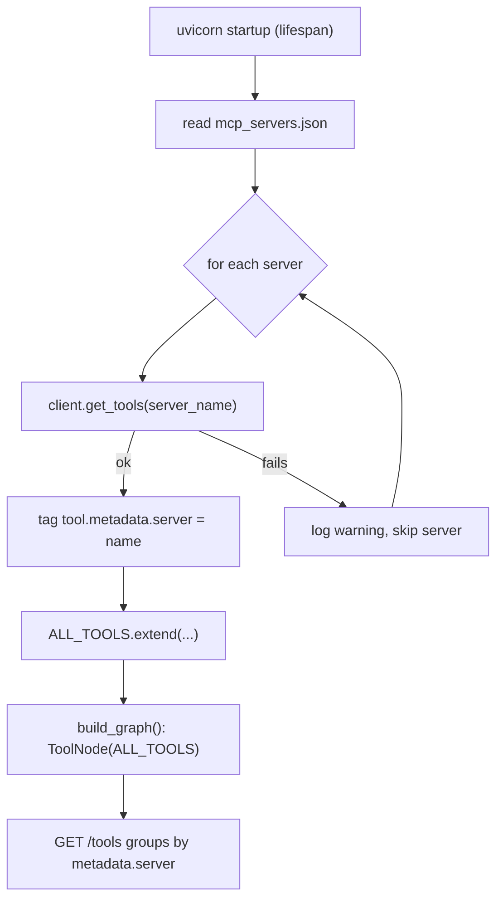
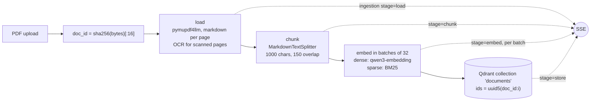
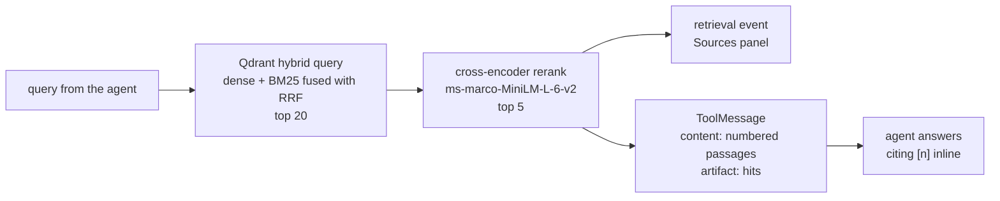
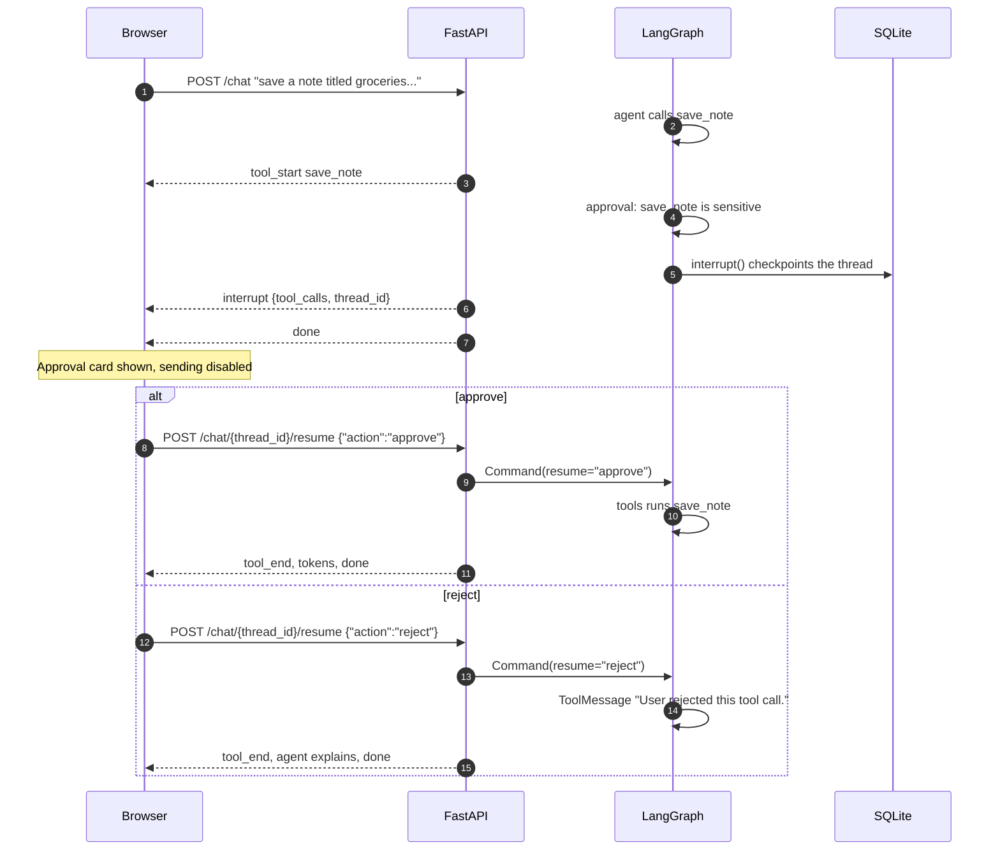
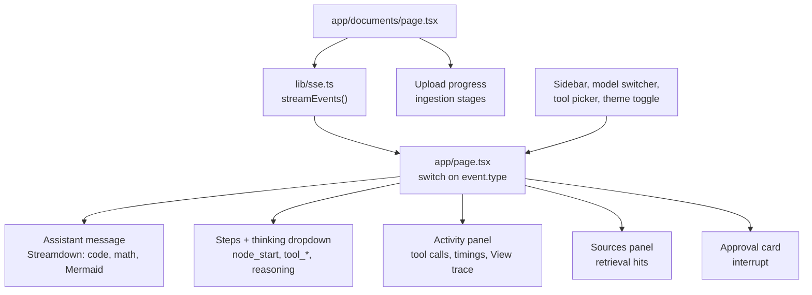
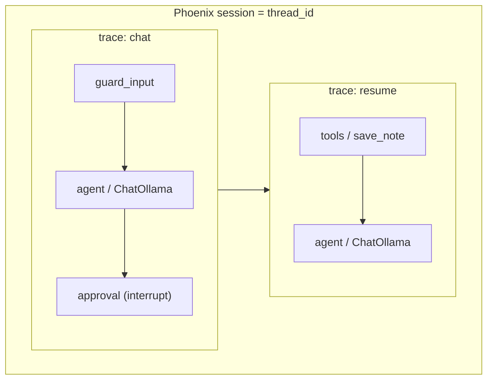
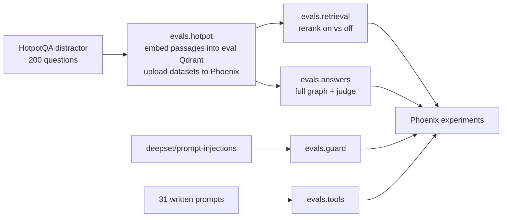

# Agent Chat

A local-first, ChatGPT/Claude-style agentic chat platform. Everything runs on your machine: models through Ollama, vectors in Qdrant local mode, threads in SQLite and traces in Phoenix.

It is a working showcase of:

- **Agent orchestration** with LangGraph (plain function nodes, direct `llm.invoke()`, no LCEL)
- **Tools and MCP**, local `@tool` functions and MCP servers side by side
- **RAG as a tool**: PDF ingestion, hybrid dense + BM25 search, cross-encoder reranking, inline citations
- **Human-in-the-loop**: sensitive tools pause the run until you approve or reject
- **Input guard**: an ONNX prompt-injection classifier in front of the agent
- **Voice**: local speech to text (Parakeet) and text to speech (Kokoro) on onnxruntime
- **Live event streaming** over SSE: tokens, reasoning, node and tool steps, retrieval hits, approvals
- **Observability and evals** with Phoenix: every chat is a trace, every eval suite is an experiment

The design notes and build order live in [docs/PLAN.md](docs/PLAN.md).

## Contents

- [Architecture](#architecture)
- [Quick start](#quick-start)
- [The agent graph](#the-agent-graph)
- [Streaming events](#streaming-events)
- [Tools and MCP](#tools-and-mcp)
- [RAG: ingestion and retrieval](#rag-ingestion-and-retrieval)
- [Human-in-the-loop](#human-in-the-loop)
- [Input guard](#input-guard)
- [Frontend](#frontend)
- [Observability](#observability)
- [Evals](#evals)
- [API reference](#api-reference)
- [Configuration](#configuration)
- [Project layout](#project-layout)
- [Extending](#extending)
- [Troubleshooting](#troubleshooting)

## Architecture



| Layer | Choice |
|---|---|
| Backend | FastAPI, uv, sse-starlette |
| Orchestration | LangGraph, plain function nodes |
| LLMs | Ollama via `ChatOllama` (qwen3, gpt-oss, llama3.1) |
| Embeddings | `qwen3-embedding:0.6b` (dense) via Ollama, fastembed `Qdrant/bm25` (sparse) |
| Rerank | fastembed `Xenova/ms-marco-MiniLM-L-6-v2`, in-process |
| PDF loading | `langchain-pymupdf4llm`, markdown per page, Tesseract OCR for scans |
| Chunking | `MarkdownTextSplitter` |
| Vector store | Qdrant local mode via `langchain-qdrant` |
| Checkpoints | SQLite (`AsyncSqliteSaver`) |
| MCP | `langchain-mcp-adapters` (`MultiServerMCPClient`) |
| Guard | `protectai/deberta-v3-base-prompt-injection-v2` on onnxruntime (no torch) |
| Voice | `onnx-asr` with `nemo-parakeet-tdt-0.6b-v2` (int8), `kokoro-onnx` with Kokoro 82M (int8) |
| Observability | Phoenix (`arize-phoenix-otel` + OpenInference LangChain instrumentation) |
| Frontend | Next.js, Tailwind, shadcn/ui, Streamdown (code, math, Mermaid) |

## Quick start

### Prerequisites

- [uv](https://docs.astral.sh/uv/) for Python (3.13)
- Node and [pnpm](https://pnpm.io/) for the frontend
- `npx` and `uvx` on your PATH (the MCP servers are launched with them)
- [Ollama](https://ollama.com/) running locally
- Optional: Tesseract, for OCR of scanned PDFs
- Optional: a [Tavily](https://tavily.com/) API key, for web search

Pull the models:

```bash
ollama pull qwen3:8b
ollama pull qwen3-embedding:0.6b
# optional, for the model switcher and evals
ollama pull llama3.1:8b
ollama pull gpt-oss
```

### Run

Start the three processes in this order, each in its own terminal:

```bash
# 1. Tracing (http://localhost:6006). Start it first, see Troubleshooting.
uvx --from arize-phoenix phoenix serve

# 2. Backend (http://localhost:8000)
cd backend && uv run uvicorn main:app --port 8000

# 3. Frontend (http://localhost:3000)
cd frontend && pnpm install && pnpm dev
```

Open http://localhost:3000. Upload a PDF on the Documents page, then ask about it in the chat.

To enable web search, create `backend/.env`:

```bash
TAVILY_API_KEY=tvly-...
```

### Try it from the terminal

Every endpoint can be exercised with `curl -N` before touching the UI:

```bash
# Stream a chat
curl -N -X POST localhost:8000/chat \
  -H 'Content-Type: application/json' \
  -d '{"message": "What is (17 + 25) * 3?"}'

# Upload a PDF and watch ingestion progress
curl -N -F file=@paper.pdf localhost:8000/documents

# Approve a paused tool call
curl -N -X POST localhost:8000/chat/<thread_id>/resume \
  -H 'Content-Type: application/json' \
  -d '{"action": "approve"}'
```

## The agent graph

The graph lives in [backend/graph.py](backend/graph.py). Every node is a plain function.



| Node | What it does |
|---|---|
| `guard_input` | Scores the latest user message with the injection classifier. At or above `guard_threshold` it emits a `guard` event and ends the turn with a refusal `AIMessage`, so thread history stays coherent. |
| `agent` | Builds `ChatOllama` for the thread's model, binds only the enabled tools, calls `llm.invoke()`. With `think` on, reasoning is moved into `reasoning_content` and streamed separately. |
| `approval` | If any tool call is in `SENSITIVE_TOOLS`, calls `interrupt()` and waits. Reject answers every call in the message with a ToolMessage so the agent can adapt. |
| `tools` | Prebuilt `ToolNode` holding all local and MCP tools. |

State is small:

```python
class ChatState(TypedDict, total=False):
    messages: Annotated[list, add_messages]
    model: str
    enabled_tools: list[str]  # missing means all tools
    think: bool
```

RAG is a tool (`search_documents`), not a fixed pipeline step. The agent decides when to retrieve.

## Streaming events

Every stream (`/chat`, `/chat/{id}/resume`, `/documents`) speaks one vocabulary: each SSE message is a JSON object with a `type` field.



| type | Payload | Source |
|---|---|---|
| `node_start` | `node` | `tasks` stream mode, a task without a `result` |
| `token` | `text` | `messages` stream mode |
| `reasoning` | `text` | `reasoning_content` on message chunks, when thinking is on |
| `tool_start` | `id`, `name`, `args` | `agent` update with tool calls |
| `tool_end` | `id`, `name`, `output` (first 500 chars), `ms` | `tools` or `approval` update |
| `retrieval` | `query`, `hits: [{doc, doc_id, page, score, text}]` | `custom`, from `search_documents` |
| `ingestion` | `doc_id`, `stage` (load / chunk / embed / store), `done`, `total` | ingestion pipeline |
| `interrupt` | `tool_calls`, `thread_id` | `__interrupt__` update |
| `guard` | `blocked`, `score` | `custom`, from `guard_input` |
| `error` | `message` | any exception in the stream |
| `done` | `trace_id`, `thread_id` | always last |

Tools emit fully formed events through `get_stream_writer()` and `/chat` forwards every `custom` chunk as is, so a new event type needs one new `case` in the frontend and nothing else.

## Tools and MCP

Local tools live in [backend/tools/](backend/tools/), one file each, registered in `ALL_TOOLS`:

| Tool | Purpose | Sensitive |
|---|---|---|
| `get_datetime` | Current local date, time and weekday | |
| `calculator` | Safe arithmetic via an AST walker (`+ - * / // % **`) | |
| `search_documents` | Hybrid search + rerank over uploaded documents | |
| `save_note` | Writes a markdown note to `notes/` | yes |
| `web_search` | Tavily search, registered only when `TAVILY_API_KEY` is set | |

MCP servers are declared in [backend/mcp_servers.json](backend/mcp_servers.json) in `MultiServerMCPClient` format and loaded once at startup:

| Server | Launch | Notes |
|---|---|---|
| `filesystem` | `npx @modelcontextprotocol/server-filesystem workspace` | Rooted at `backend/workspace/`. `write_file`, `edit_file`, `move_file`, `create_directory` need approval. |
| `fetch` | `uvx mcp-server-fetch` | Fetches a URL as markdown. |



MCP tools behave exactly like local ones: the agent binds them, `ToolNode` runs them, and `tool_end` uses `msg.text` so MCP content blocks read like plain output. Sessions are stateless, one stdio process per call, so each call pays the spawn cost (around 20s for the `npx` filesystem server).

## RAG: ingestion and retrieval

### Ingestion

`POST /documents` saves the upload to `uploads/` and streams progress while [backend/ingestion/pipeline.py](backend/ingestion/pipeline.py) runs. Blocking work runs in a thread.



- Ids are stable (sha256 of the file, uuid5 per chunk), so re-uploading a file overwrites rather than duplicates.
- Dense and sparse vectors are both stored at ingest time, so hybrid search never needs a re-ingest.
- Each chunk keeps `doc_id`, `doc`, `page` and `chunk_index` in its metadata.

### Retrieval



Sources ride on the `search_documents` ToolMessage `artifact` rather than a separate state key. That avoids reducer conflicts on parallel calls and keeps sources tied to their turn in the checkpointed history. Page numbers from pymupdf4llm are 0-indexed and shown 1-indexed.

## Human-in-the-loop

Threads are checkpointed in SQLite, so a run can pause in the middle and pick up in a later request.



`/resume` returns `409` if the thread has no pending approval. A resumed run streams into the same assistant message in the UI, and both the chat and its resumes share one Phoenix session (`session.id = thread_id`).

## Input guard

[backend/guard.py](backend/guard.py) runs `protectai/deberta-v3-base-prompt-injection-v2` with onnxruntime and tokenizers, no torch. The model is downloaded from Hugging Face on first use and cached.

- Only the user message is checked. Tool and RAG output are not (that is a future `guard_output` node).
- Messages scoring `>= 0.9` are blocked. Benign text containing words like "ignore" can score around 0.88, so the threshold stays high. The [guard eval](#evals) reports precision and recall at 0.5, 0.7 and 0.9.
- A block emits a `guard` event, logs a warning, and ends the turn with a refusal whose score sits in `response_metadata`.

## Frontend

The Next.js app in [frontend/](frontend/) calls the API directly with CORS. A Next proxy could buffer SSE, so there is none. Streams are read with `fetch` and a 25 line parser in [frontend/lib/sse.ts](frontend/lib/sse.ts), since `EventSource` cannot POST.



| Feature | Detail |
|---|---|
| Model switcher | Lists `chat_models` from `/models`. The thinking toggle appears only for models with Ollama's `thinking` capability. |
| Tool picker | Per-chat toggles from `/tools`, grouped by `local` or MCP server, sensitive tools marked. Stored in graph state, so resumes keep them. |
| Activity panel | Tool calls with args, output and timing for the selected turn, plus a "View trace" link to Phoenix. |
| Sources panel | Reranked passages with document, page and score. |
| Documents page | Upload with live per-stage progress. Lists uploads from the current browser session only (there is no list endpoint yet). |

## Observability

`phoenix.otel.register(auto_instrument=True)` traces every LangChain and LangGraph call. Each request opens one root span (`chat`, `resume` or `ingest`) with the user input and final answer, and FastAPI's own request tracing is turned off so Phoenix shows only the useful spans.



The `done` event carries the `trace_id`, and the UI links to Phoenix's `/redirects/traces/{trace_id}`, which resolves the project itself. Traces go to the `agent-chat` project.

## Evals

One suite per component in [backend/evals/](backend/evals/), on public or written datasets, with our own evaluators, all run as Phoenix experiments. Importing `evals` points Qdrant at a separate `eval_qdrant_data/` folder, so real uploads stay untouched and there is no lock clash with a running backend.



| Suite | Dataset | What it measures |
|---|---|---|
| `evals.retrieval` | `hotpot-retrieval-v1` (200 HotpotQA questions) | hit@5, recall@5 and MRR over gold paragraph titles, with and without the reranker |
| `evals.answers` | `hotpot-answers-v1` (50 questions) | Full graph with only `search_documents` enabled: used-search, contains-answer, answer-recall, and a faithfulness judge (`gpt-oss`, never grading its own answers) for `qwen3:8b` and `llama3.1:8b` |
| `evals.guard` | `deepset/prompt-injections` test split | Accuracy, missed injections and false blocks, plus a precision / recall / FPR table at 0.5, 0.7 and 0.9 |
| `evals.tools` | `tool-routing-v1` (31 written prompts) | Whether the first agent step calls the expected tool, or none, per model |

Run them with Phoenix and Ollama up. The backend can keep running, since the evals use their own Qdrant folder:

```bash
cd backend
uv run python -m evals.hotpot      # once: builds the eval store and uploads the HotpotQA datasets
uv run python -m evals.retrieval
uv run python -m evals.answers     # slow: full graph runs plus a judge call per question
uv run python -m evals.guard
uv run python -m evals.tools
```

Each suite prints mean scores to the terminal; the per-example runs and comparisons are in Phoenix under Datasets.

## API reference

| Method | Path | Body | Returns |
|---|---|---|---|
| `POST` | `/chat` | `{message, model?, thread_id?, enabled_tools?, think?}` | SSE stream. A new `thread_id` is created when omitted. |
| `POST` | `/chat/{thread_id}/resume` | `{"action": "approve" \| "reject"}` | SSE stream, or `409` with no pending approval |
| `POST` | `/documents` | multipart `file` | SSE stream of `ingestion` events, then `done` |
| `GET` | `/documents/{doc_id}` | | `{doc_id, chunks}` |
| `GET` | `/models` | | `{models: [{name, thinking}], default}` |
| `GET` | `/tools` | | `[{name, description, group, sensitive}]` |
| `POST` | `/voice/transcribe` | multipart `file` (16-bit PCM WAV) | `{text}`, or `400` for unreadable audio |
| `POST` | `/voice/speak` | `{text}` (1 to 1000 chars) | `audio/wav`, 24 kHz mono |

The first voice call downloads its model (about 650 MB for speech to text, 140 MB for text to speech), so it takes a while once. After that a sentence takes well under a second each way.

`enabled_tools` left out keeps the thread's earlier choice; never set means all tools.

## Configuration

Backend settings are in [backend/config.py](backend/config.py) (pydantic-settings). Any field can be overridden by an environment variable or `backend/.env`, for example `DEFAULT_MODEL=llama3.1:8b`.

| Setting | Default | Notes |
|---|---|---|
| `ollama_url` | `http://localhost:11434` | |
| `default_model` | `qwen3:8b` | |
| `chat_models` | `qwen3:8b`, `gpt-oss:latest`, `llama3.1:8b` | Offered in the model switcher; need Ollama's `tools` capability |
| `phoenix_endpoint` | `http://localhost:6006/v1/traces` | |
| `phoenix_project` | `agent-chat` | |
| `tavily_api_key` | empty | `web_search` is registered only when set |
| `cors_origins` | `["http://localhost:3000"]` | |
| `qdrant_path` / `qdrant_collection` | `qdrant_data` / `documents` | |
| `embedding_model` / `sparse_model` | `qwen3-embedding:0.6b` / `Qdrant/bm25` | |
| `chunk_size` / `chunk_overlap` | `1000` / `150` | |
| `retrieval_k` / `rerank_top_n` | `20` / `5` | |
| `rerank_model` | `Xenova/ms-marco-MiniLM-L-6-v2` | |
| `guard_model` / `guard_threshold` | `protectai/deberta-v3-base-prompt-injection-v2` / `0.9` | |
| `upload_dir`, `notes_dir`, `db_path` | `uploads`, `notes`, `app.db` | |
| `mcp_config` / `mcp_workspace` | `mcp_servers.json` / `workspace` | The workspace must match the filesystem root in the JSON |
| `stt_model` | `nemo-parakeet-tdt-0.6b-v2` | Any `onnx-asr` model name; English only by default |
| `tts_voice` / `tts_speed` | `af_heart` / `1.0` | Kokoro voice names are listed in its VOICES.md |
| `voice_dir` | `voice_models` | Kokoro files, downloaded on first use |

Frontend environment:

| Variable | Default |
|---|---|
| `NEXT_PUBLIC_API_URL` | `http://localhost:8000` |
| `NEXT_PUBLIC_PHOENIX_URL` | `http://localhost:6006` |

Local data (`qdrant_data/`, `eval_qdrant_data/`, `uploads/`, `notes/`, `workspace/`, `voice_models/`, `*.db`, `.env`) is created inside `backend/` and gitignored.

## Project layout

```
backend/
  main.py             FastAPI app, lifespan, CORS, include_router
  routes/             one APIRouter per URL prefix: chat, threads, documents, catalog, voice
  stream.py           graph stream to SSE events
  tracing.py          Phoenix register() and shared tracer
  graph.py            ChatState, nodes, build_graph()
  guard.py            prompt-injection classifier (onnx)
  events.py           event(type, **data) helper
  config.py           settings
  mcp_servers.json    MCP servers loaded at startup
  tools/              one file per tool, ALL_TOOLS and SENSITIVE_TOOLS in __init__.py
  ingestion/          loader, chunking, store, pipeline
  retrieval/          hybrid search, rerank
  voice/              speech to text (stt.py), text to speech (tts.py)
  evals/              hotpot setup, retrieval, answers, guard, tools suites
frontend/
  app/                chat page, documents page
  components/         sidebar, steps, activity, sources, approval card, tool picker
  lib/sse.ts          POST + SSE reader
docs/
  PLAN.md             design, decisions log, build order
```

## Extending

The rule is extend by adding, not rewiring.

- **A tool:** add a file in `backend/tools/` with an `@tool` function and one line in `ALL_TOOLS`. If it has side effects, add its name to `SENSITIVE_TOOLS` and it gets an approval card for free.
- **An MCP server:** add an entry to `mcp_servers.json`. Its tools appear in `/tools` grouped under the server name. Add any write tools to `SENSITIVE_TOOLS`.
- **A model:** `ollama pull` it and add it to `chat_models`. Thinking support is detected from Ollama.
- **An event:** call `get_stream_writer()({"type": "...", ...})` from a node or tool, then add one `case` in the frontend.

## Troubleshooting

- **Every request is slow.** Phoenix is probably down; span export retries block requests. Start Phoenix before the backend.
- **Qdrant "already accessed by another instance".** Local mode locks the folder to one process. Inspect it through the API, or stop uvicorn first. The evals use their own folder for this reason.
- **The first filesystem MCP call takes ~20s.** Each call spawns a fresh `npx` process. Expected for now.
- **`web_search` is missing from the tool picker.** Set `TAVILY_API_KEY` in `backend/.env` and restart.
- **A model has no thinking toggle.** Only models whose Ollama capabilities include `thinking` get one; a model that is not pulled shows without it.
- **Prices render as math.** Inline `$...$` math is on in Streamdown, so text with two dollar amounts can occasionally be read as a formula.
